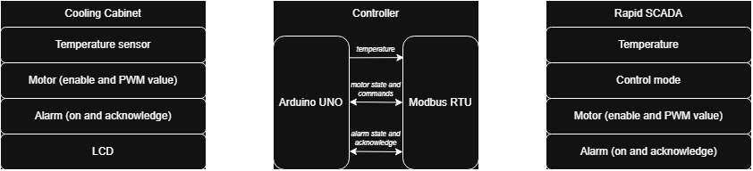
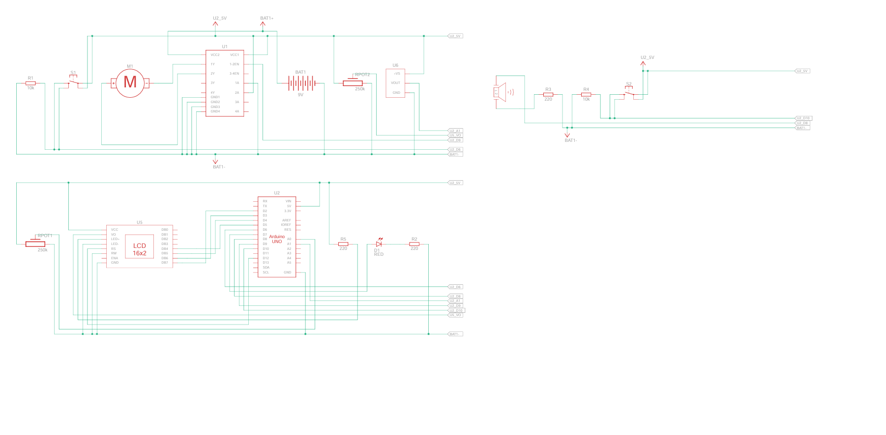
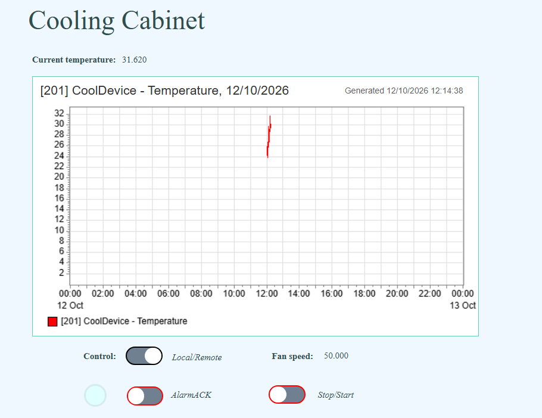

# Cooling Cabinet Monitoring and Control System

An embedded monitoring and control project built around an Arduino Uno, C++, Modbus RTU, and Rapid SCADA. The project explores how hardware-level sensing and control can be connected to a supervisory monitoring interface.

## 🌟 Highlights
- **Embedded C++:** Object-oriented organization of sensors, actuators, alarm and control logic.
- **Hardware integration:** Temperature sensing, LCD display, push buttons, LED, buzzer and motor control.
- **Industrial communication:** Modbus RTU for exchanging monitoring and control data with Rapid SCADA.
- **SCADA visualization:** A supervisory interface for monitoring temperature, motor status and alarm conditions.

## ℹ️ Overview
The Cooling Cabinet project is a practical exploration of embedded systems, hardware integration and industrial automation concepts.

An Arduino Uno runs the application logic, reads sensor inputs, manages local indicators and alarms and controls the motor. An LCD provides local feedback, while Modbus RTU enables communication with Rapid SCADA for supervisory monitoring and control.

The project brings together embedded C++, serial communication, control logic and SCADA visualization in a single system.

## 🏗️ System architecture

The architecture diagram illustrates the main components and communication paths between the embedded controller, connected hardware, Modbus RTU communication and the SCADA layer.

## ⚡️Hardware and Electrical Connections

The electrical schematic documents the connections between the Arduino Uno and its peripherals, including the sensor, user inputs, indicators, display and motor-control components.

## 📈 SCADA Interface

The Rapid SCADA scheme provides a visual overview of the system's monitored values and status indicators. The interface is intended to make important operating conditions easier to inspect at a glance.

## 🚧 Project Status

This project is a work in progress. It serves as a practical learning and portfolio project focused on embedded programming, hardware interfacing, industrial communication and SCADA integration. Future development includes an STM32 Blue Pill-based diagnostic unit to extend the system's diagnostic capabilities and explore communication between multiple microcontrollers.
